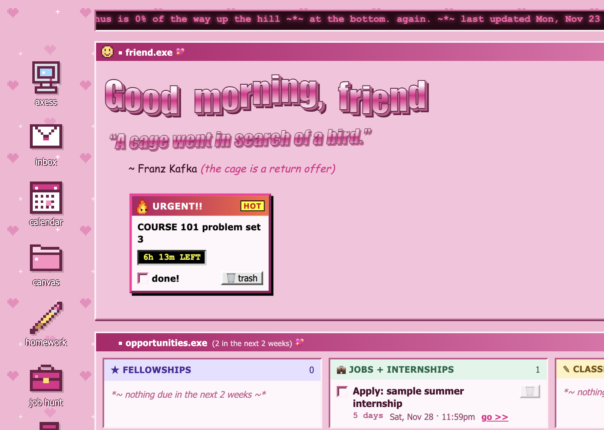

# Homepage dashboard (pink 98)

A Windows 98–style Chrome new-tab page, kept up to date every morning by a scheduled Claude task. It reads your Gmail, Google Calendar and the news, then fills in:

- a WordArt greeting and a daily existential quote
- a fire banner for anything due in the next 24 hours
- homework, job hunt, social and admin to-do lists, with stick-figure Sisyphus pushing his boulder up the hill as you check things off
- a next-class ticker, a news carousel, a week-at-a-glance social calendar and a game mode with XP and stickers



The page is plain HTML/CSS/JS. Nothing is hosted and nothing leaves your computer: it runs from a local folder over `file://`.

## Quick start (5 minutes, no Claude needed)

1. Click **Use this template** on GitHub (or download the ZIP) and put the folder somewhere permanent, e.g. `Documents/Claude/Homepage`.
2. Open `config.js` and set your `name` and course links.
3. Optional: refresh the demo dates with `python3 tools/make_sample_data.py`.
4. Open `dashboard.html` in Chrome. You'll see sample data.

### Make it your new tab

Install the **New Tab Redirect** extension (or any extension that opens a local file), then:

1. In `chrome://extensions`, open the extension's **Details** and turn on **Allow access to file URLs**.
2. Set its redirect URL to `file:///<path to your folder>/dashboard.html`.

## Make it update itself (Claude Cowork)

You need the Claude desktop app with Cowork, and the Gmail and Google Calendar connectors turned on.

1. In Cowork, select your Homepage folder.
2. Open `docs/SCHEDULED-TASK-PROMPT.md` and replace the placeholders (`YOUR_NAME`, `YOUR_EMAIL`, `YOUR_HOMEPAGE_FOLDER`).
3. Replace `YOUR_EMAIL`, `YOUR_TIMEZONE` and `YOUR_OTHER_CALENDARS` in the three files in `tools/helpers/`.
4. Ask Claude: *"Create a scheduled task called homepage-dashboard that runs daily at 7 AM, using the prompt in docs/SCHEDULED-TASK-PROMPT.md."*
5. Click **Run now** once to test it. Your sample data is replaced with your real day.

The task is read-only on your accounts. It never sends email, RSVPs, edits calendar events or changes read/unread. It only writes `data.js`, `tasks-archive.js` and `usage-log.csv`.

Optional extras:

- **Course prep list.** Give Claude your syllabi and ask it to fill `courses.js` (format in `docs/DATA-CONTRACT.md`).
- **Usage log.** `tools/log_usage.py` appends each run's token usage to `usage-log.csv`, so you can see what a run costs.

## How it fits together

```
Gmail + Calendar + web ──► scheduled Claude task ──► data.js ──► dashboard.html (+ assets/)
                            (3 helper agents +                     reads it on every new tab
                             tools/homepage_tools.py)
```

| Path | What it is |
|---|---|
| `dashboard.html`, `assets/` | the page: look and behaviour |
| `config.js` | your name and course links |
| `data.js` | everything the page shows; **written by the scheduled task** |
| `courses.js` | optional static course-prep tasks |
| `tasks-archive.js` | tasks more than 21 days old (still shown) |
| `tools/homepage_tools.py` | merge and validation script the task runs |
| `tools/helpers/` | briefs for the email, calendar and news helper agents |
| `docs/DATA-CONTRACT.md` | the exact shape of `data.js` |
| `docs/DESIGN.md` | design history, page map and how to redesign safely |

## Rules that keep it from breaking

1. **Never change or reuse a task `id`.** Checkmarks, trash and XP are saved in your browser's localStorage by id. Old tasks move to `tasks-archive.js`; they're never deleted.
2. **Keep design and data separate.** The scheduled task never touches `dashboard.html` or `assets/`. Design work never hand-edits `data.js`.
3. **Redesign on a copy.** Copy the folder to `Homepage-lab/`, experiment there, and swap it in when you like it.

## Privacy: read this before you push your copy

Once the task runs, `data.js`, `courses.js` and `tasks-archive.js` contain your real to-dos, deadlines and Gmail links. If you keep your copy on GitHub:

- make your repo **private**, or
- stop tracking your data before your first real run:
  ```
  git update-index --skip-worktree data.js courses.js tasks-archive.js
  ```

`usage-log.csv` and `backups/` are already in `.gitignore`.

## Customising

Change anything by asking Claude in Cowork with your Homepage folder selected, e.g. *"add a widget for my gym schedule"* or *"make a lilac theme"*. Point it at `docs/DESIGN.md` first; it explains the page map and the taste rules.

## License

MIT. See `LICENSE`.
